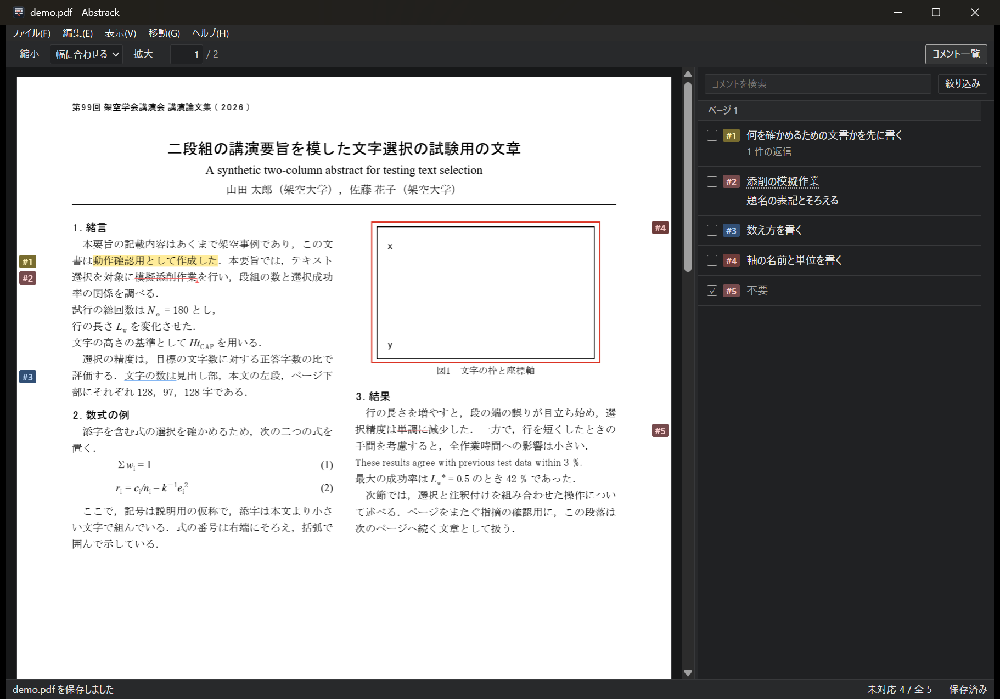

# Abstrack

論文のPDFに添削コメントを入れ、筆者がそのコメントを見ながら原稿を直すための、Windows用PDFリーダーです。コメントはPDFの標準コメントとして保存され、Adobe Acrobatとの互換性があります。



## 軽量！高速！シンプル！

Tauri と OS 標準の WebView2 で動作し、ブラウザエンジンを同梱していません。インストーラーは約 5.6 MB、インストール後のサイズは約 20 MB です。

200ページ・コメント500件のPDFを開いたときの、Adobe Acrobat Pro 26.003との比較です。

| | Abstrack | Acrobat |
|---|---:|---:|
| 起動から1ページ目の表示まで | 0.56 秒 | 1.23 秒 |
| ページとコメント一覧の表示まで | 1.3 秒 | 5.6 秒 |
| 起動12秒後のメモリ使用量 | 123 MB | 352 MB |

Windows 11、Core i7-10700F、メモリ 32 GB、FHD ディスプレイでの計測値です。メモリ使用量は、WebView2 を含む各プロセスが他と共有していない物理メモリの合計です。

## インストール

ビルド済みのインストーラーは配布していないため、ソースからビルドします。前提条件は「開発」の節にあります。

```
npm install
npm run fetch-pdfium
npm run tauri build
```

`target/release/bundle/nsis/Abstrack_0.1.0_x64-setup.exe` が生成されます。未署名なので、実行時に警告が出ます。「詳細情報」→「実行」で進めてください。

## 使い方

1. コメントしたい文字をドラッグで選択する
2. キーを1つ押して、コメントの種類を決める

   | キー | コメント |
   |---|---|
   | H | ハイライト |
   | R | 置換 |
   | D | 取り消し線 |
   | U | 下線 |
   | I | 挿入 |
   | N | メモ |
   | Alt+ドラッグ → Enter | 長方形 |

3. コメント一覧に入力欄が開くので、指摘を書いて Enter。改行は Shift+Enter。置換と挿入では、1行目が置換後・挿入する文字列、2行目以降がその説明になる
4. Ctrl+S で元のPDFに上書き保存

Ctrl+Z で元に戻せます。コメントを選択して Enter で編集、Delete で削除です。コメントの範囲は、両端のハンドルをドラッグして調整できます。

## 設定

メニューから変更します。

- 「編集」→「コメントの作成者名」: 新しいコメントに付く作成者名。空欄なら OS のログイン名です
- 「編集」→「コメントの色」: 新しいコメントの色を種類ごとに指定
- 「表示」→「一覧の文字を大きく」「一覧の文字を小さく」: コメント一覧の文字サイズ

設定ファイルは `%APPDATA%\app.abstrack.desktop\settings.json` です

## 構成

| パス | 内容 |
|---|---|
| `crates/pdf_io` | PDFの解析と増分更新 |
| `crates/annot` | コメントの読み書き |
| `crates/textmodel` | 行・段・読み順の組み立てとテキスト選択 |
| `crates/render` | PDFium による描画と文字位置の取得 |
| `crates/annot-dump` | コメントを一覧表示する開発用コマンド |
| `src-tauri` | アプリ本体（Tauri 2） |
| `src` | フロントエンド（Svelte 5 + TypeScript） |

## 開発

前提条件: Rust 1.89 以上、Node.js、[Tauri 2 の前提条件](https://tauri.app/start/prerequisites/)

```
npm install
npm run fetch-pdfium
npm run tauri dev
```

`npm run fetch-pdfium` は [bblanchon/pdfium-binaries](https://github.com/bblanchon/pdfium-binaries) のビルド済み PDFium を `vendor/pdfium/` にダウンロードし、SHA-256 を検証します。

テストとリント:

```
cargo test --workspace
cargo clippy --workspace --all-targets
npm run check
```

PDFium が未取得の場合、PDFium を使うテストはスキップされます。qpdf による構造検査も、`C:\Program Files\qpdf 12.4.2\bin\qpdf.exe` が無ければスキップします。

手持ちのPDFに Acrobat でコメントを入れて `ref/` に置くと、それらを使うテストも実行されます。返信やステータスが元のコメントにまとまるか、ハイライトや取り消し線が覆う文字をこのアプリでも同じ範囲として選べるかを確かめます。

## 制限事項

- 動作確認は Windows 11（x64）のみ。macOS 用のビルド設定はあるが、実機では未確認です
- インストーラーは未署名です
- 暗号化されたPDF、電子署名付きのPDF、相互参照が壊れたPDFは閲覧専用です
- 同じPDFを Acrobat と同時に開き、両方から保存することは避けてください。外部で書き換えられた場合は通知し、上書きはしません。

## ライセンス

MIT ライセンスで公開しています。詳細は [LICENSE](LICENSE) を参照してください。

利用している第三者ソフトウェアのライセンスは [THIRD_PARTY_LICENSES.md](THIRD_PARTY_LICENSES.md) にまとめています。
